# Margins

A deeply customizable ePub reader for **macOS** and **Windows**. Pick from 31 bundled reading fonts (or your own), tune spacing down to a hundredth of an em, choose from 28 color schemes, highlight in ten styles, turn pages with nine animations and any input you like, and see exactly how much you read.

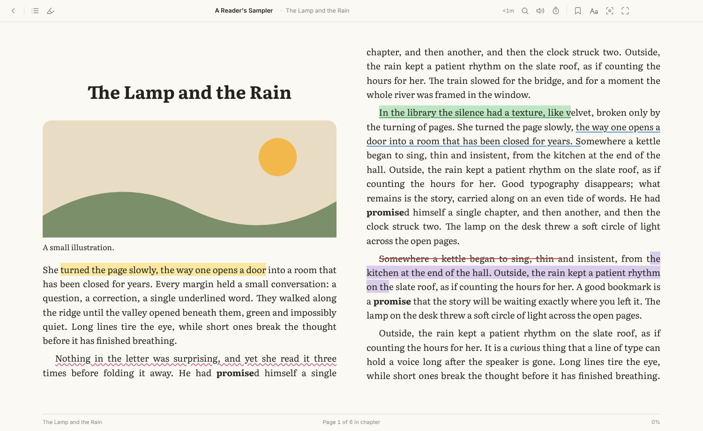

## Features

**Typography**
- 31 bundled open-license fonts — Literata, EB Garamond, Crimson Pro, Source Serif, Lora, Merriweather, Newsreader, Spectral, Vollkorn, Inter, IBM Plex, Atkinson Hyperlegible, Lexend, OpenDyslexic, Andika, JetBrains Mono and more
- Add your own `.ttf` / `.otf` / `.woff` / `.woff2` files, or use any font installed on your computer
- Font size, weight, bold weight, stroke thickening, ligatures, old-style numerals, font smoothing
- Separate heading font, heading size, small-caps headings, drop caps
- Three levels of control over the book's own CSS: respect it, mix, or override everything

**Spacing**
- Line, letter and word spacing; paragraph spacing and first-line indent
- Alignment (book / left / justify / center)
- Split words across lines automatically, only where the book allows, or never
- Line length measured in characters, so it scales with the font size
- Side and top/bottom margins that shrink gracefully on small windows
- One page, two pages, or automatic spreads that appear only when each page can hold a full line
- The page stays put when you resize the window or change settings

**Color & atmosphere**
- 28 color schemes: Paper, Sepia, Cream, Parchment, Mint, Sky, Rose, E-ink, Solarized, Gruvbox, Nord, Dracula, Night, OLED black, Red Night, Terminal, high-contrast and more
- Build and save your own schemes
- Paper textures under the page — fine grain, cotton, laid, linen, vellum, recycled, newsprint, parchment, cold press, or your own image — with strength and scale; they turn with the page
- An optional crease down the middle of two-page spreads, like an open book, with adjustable darkness and width
- Pages don't have to fill the window: put a desk at the sides and above and below, in any color, with optional rounded page corners (they turn with the page)
- Page layouts (Full window, Open book, Paperback, Single page, Roomy, Compact) that set one or two pages, margins, line length, desk, corners and crease — alongside style templates, which set type, color and motion
- Every color can be changed: any theme's colors (built-in ones can be restored), bars and the line beside them, desk and the highlight palette
- Search box in Reading settings that finds any setting across every tab
- Top and bottom bars are separate bands; the crease stays on the pages
- On Windows, a flicker fix for hardware acceleration (off, standard or strong)
- Extra brightness dimming, a warm night-light and vignette
- Follow the system's dark mode with a theme of your choice
- Dim or invert images

**Highlights & notes**
- Nine colors plus any custom color
- Ten styles: highlight, marker, underline, squiggle, dotted, dashed, double underline, strikethrough, colored text, glow
- Notes on any highlight, bookmarks, copy with citation, define (Wiktionary), Wikipedia, speak
- Filter by color, style or text; export to Markdown, HTML or JSON; import JSON

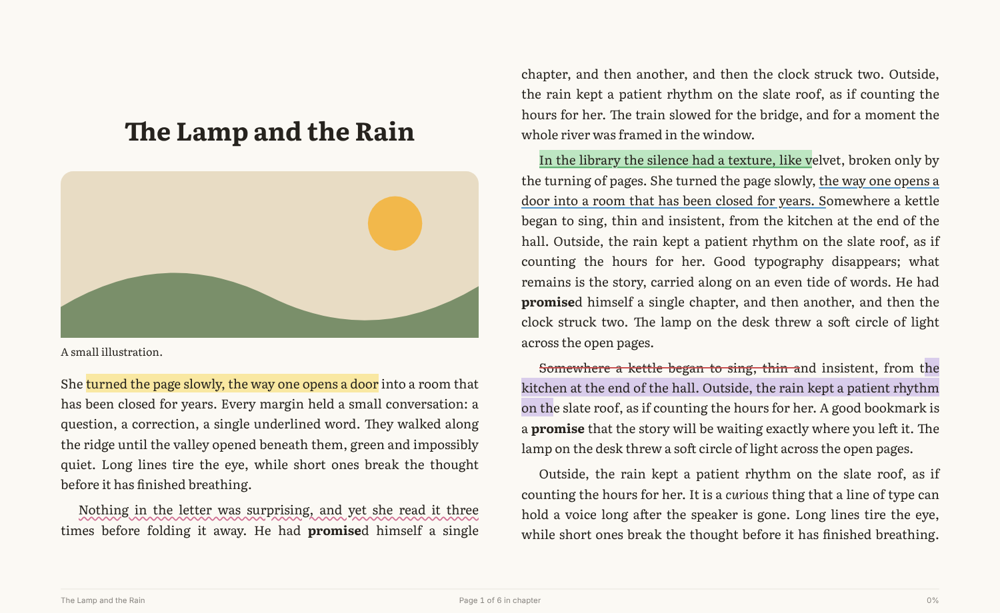

**Page turning**
- **Page curl** like Apple Books: the page bends around a moving fold, with lighting, the real next page printed on the back of the turning leaf, and soft shadows, drawn with WebGL. Choose whether the bottom corner, the top corner or the whole edge leads. Grab the margin beside the text and drag to turn it by hand; let go early and it falls back
- In a two-page spread only one leaf turns, around the spine: forward the right page turns over onto the left; back, the left page returns to the right
- Also: a stiff flip, slide, push, cover, fade, zoom and rise, all working from a snapshot of the spread so both pages always move together, with live previews in settings
- Every animation works from real pictures of the pages: the pages either side (and one further) are rendered ahead of time in a hidden window, so a turn starts on the next frame, the arriving page is complete from the first frame, and the live book is only revealed once it has fully drawn. Turns animate with the settings or sidebar open too. This works with hardware acceleration off too, and the curl adapts its resolution to keep the frame rate up on slower machines
- Paginated, scroll-a-chapter, or endless scroll
- Click/tap zone layouts (thirds, Kindle-style, halves, one-handed, tap-anywhere, top/bottom) with a live diagram, and a left-handed swap
- Arrow keys, Space, Page Up/Down (Bluetooth page-turner pedals and presentation clickers), Vim keys, WASD, media & volume keys
- Mouse wheel, trackpad swipe, touch swipe
- Game controllers (bumpers, triggers, D-pad, stick)
- Hands-free auto-turn on a timer and teleprompter-style auto-scroll

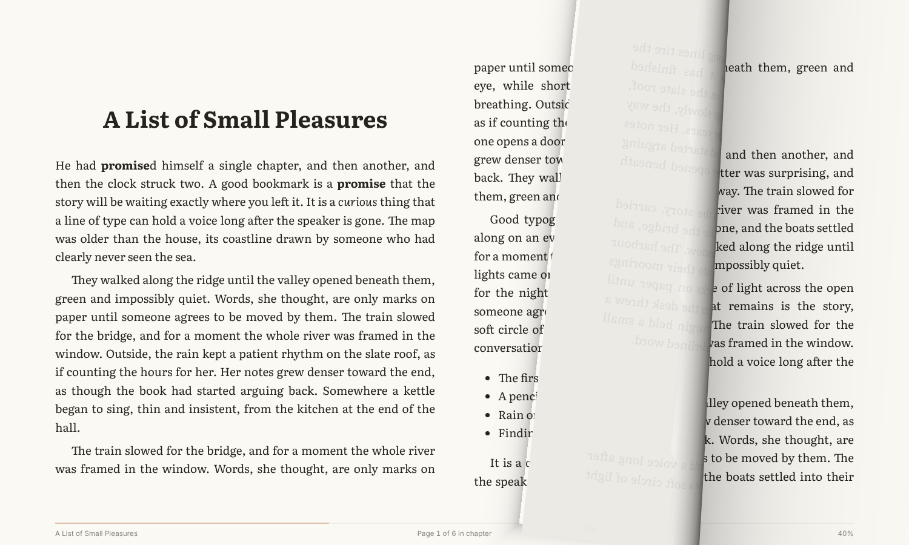

**Templates**
- 14 one-click looks: Classic Novel, Modern Essay, Comfort, Night Owl, Lights Out, Dyslexia Friendly, Large Print, Compact, Academic, E-ink, Speed Reader, Typewriter, Manuscript
- Save your own; settings can apply to every book or just the one you're reading

**Focus aids**
- Reading ruler: line, band or spotlight, mouse- or keyboard-driven
- Fixation emphasis (bionic-style) that dims word endings without touching the book
- Focus mode and full screen; bars fade away while you read

**Reading stats**
- Only active reading counts — idle time and background time are excluded
- Daily goal ring, streaks, weekly totals, words-per-minute pace, pages and words read
- 30-day chart, 26-week calendar heatmap, time-of-day histogram, per-book table, recent sessions
- Time left in the chapter and the book, from your own pace
- Export as JSON

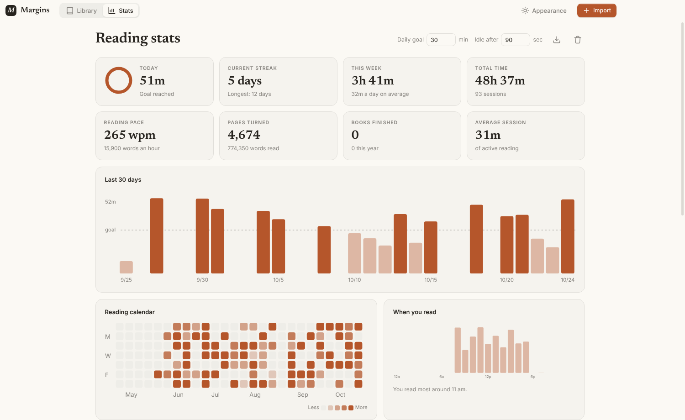

**Library**
- Import by dialog, drag and drop, or "Open with" from Finder/Explorer
- Covers (or generated ones), shelves (reading, not started, finished, favorites), tags, search, six sort orders, grid or list, adjustable cover size
- Continue-reading card, book info, edit title/author

**Also**
- Full-text search, collapsible table of contents with percentages, go to percentage, progress scrubber
- Read aloud with system voices, word-by-word highlighting, automatic page turning
- Right-to-left books turn the right way
- Hardware acceleration is on by default. On Windows a flicker fix (Reading settings → App → Display) handles GPUs that flicker, notably NVIDIA with HDR, and colors are pinned to sRGB for HDR / auto-HDR setups
- Everything stays on your computer

## Screenshots

| | |
|---|---|
| 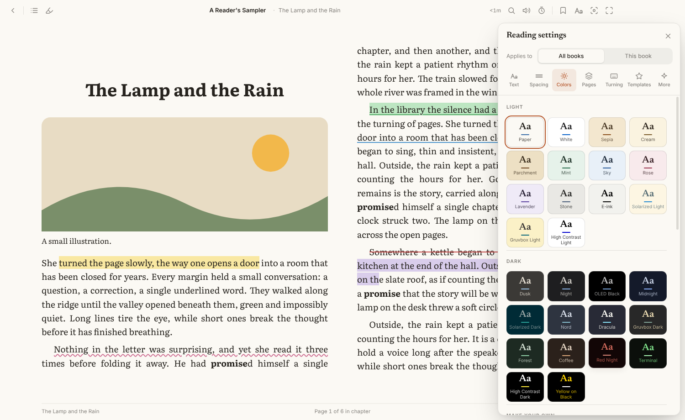 | 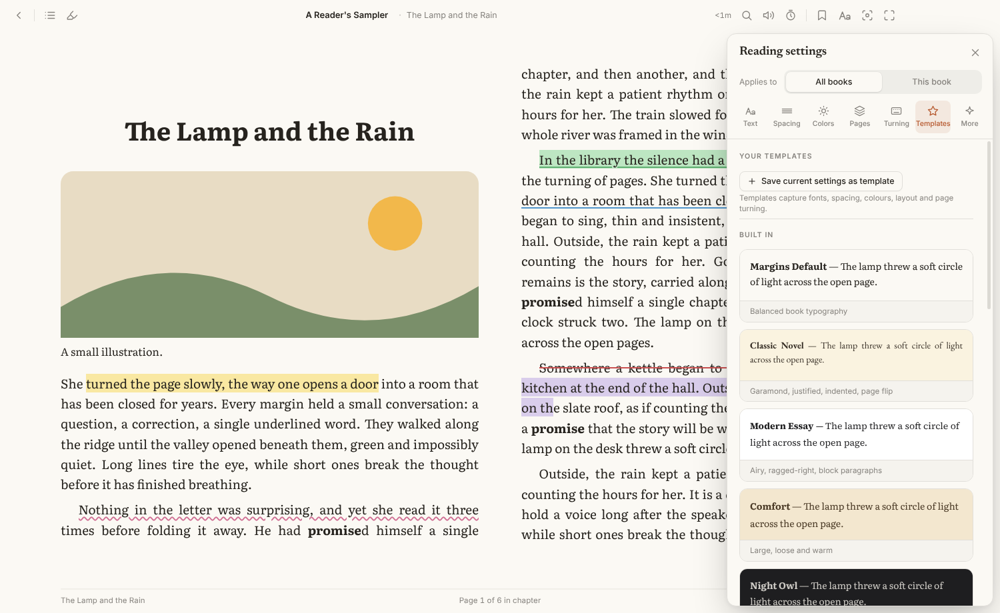 |
| 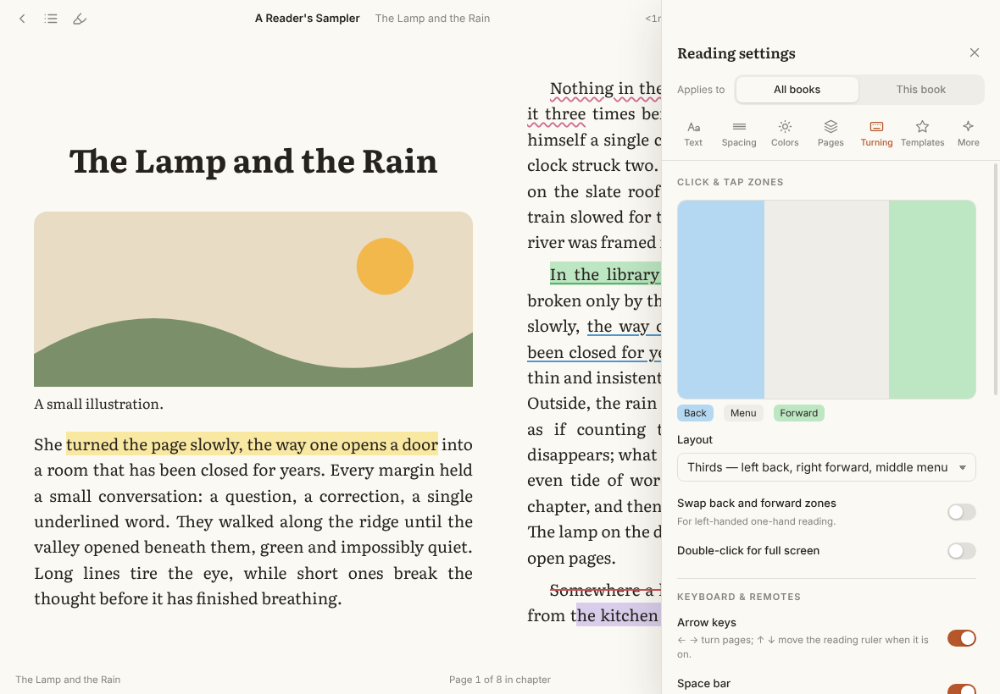 | 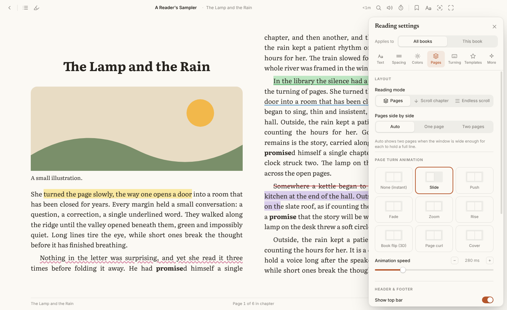 |
| 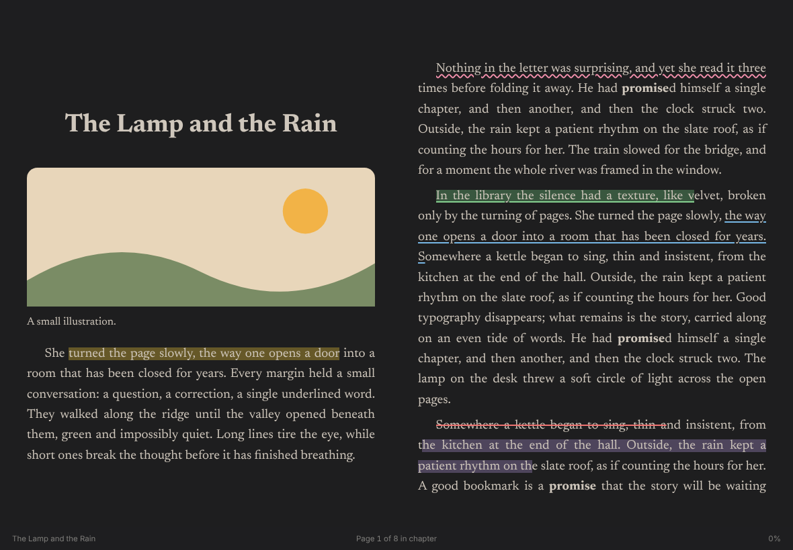 | 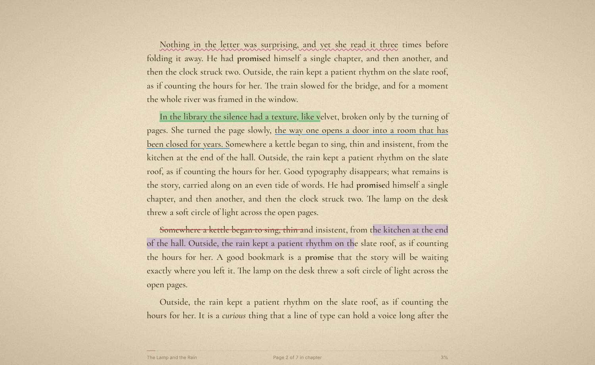 |
| 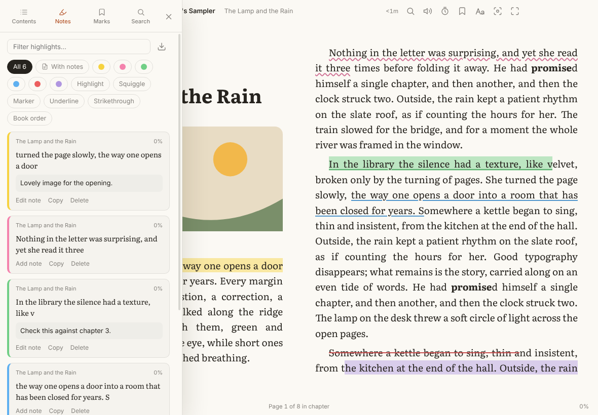 | 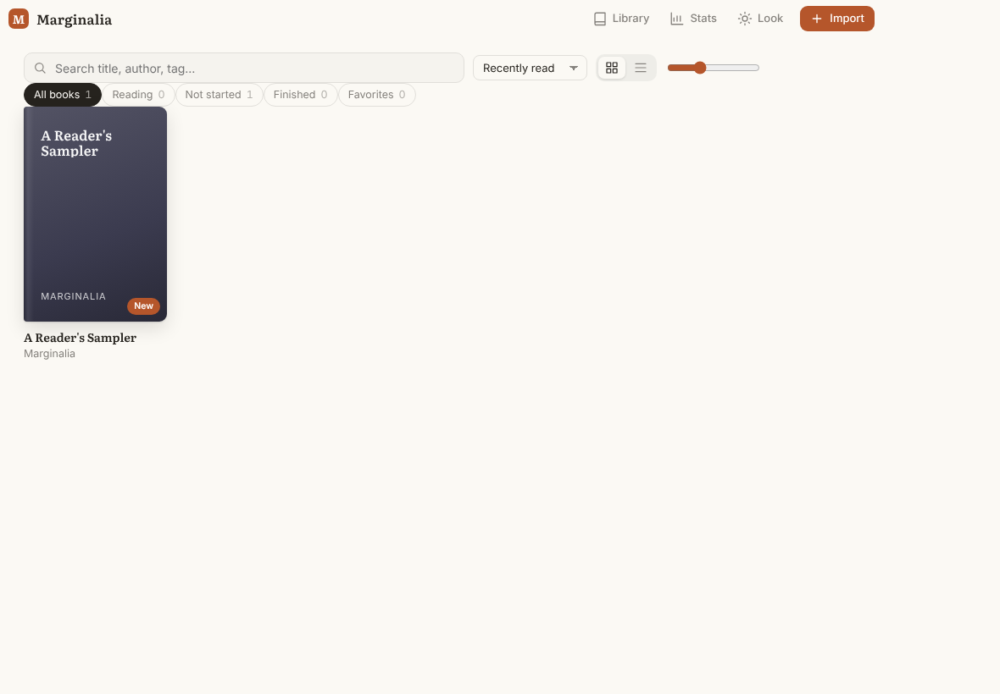 |

## Install

Download the latest `.dmg` (macOS, Apple Silicon or Intel) or `.exe` (Windows installer or portable) from [Releases](https://github.com/HarvielArcilla/margins/releases).

The builds are not code-signed yet:
- **macOS:** right-click the app → **Open** the first time, or run `xattr -dr com.apple.quarantine /Applications/Margins.app`.
- **Windows:** in the SmartScreen prompt choose **More info → Run anyway**.

## Build from source

Requires Node.js 20 or newer.

```bash
git clone https://github.com/HarvielArcilla/margins.git
cd margins
npm install          # also copies the bundled fonts into src/renderer/fonts
npm start

npm run sample-book  # optional: writes samples/sample.epub to try things out

npm run dist:mac     # → dist/*.dmg, *.zip
npm run dist:win     # → dist/*.exe
```

Pushing a tag like `v1.0.0` runs the GitHub Actions workflow, which builds both platforms and attaches the installers to a release.

## Keyboard shortcuts

| Keys | Action |
|---|---|
| → Space PgDn J L | Next page |
| ← Shift+Space PgUp K H | Previous page |
| P · [ ] | Auto-turn / auto-scroll · slower / faster |
| T · N · / · B | Contents · notes · search · bookmark |
| , | Reading settings |
| + − 0 | Text size |
| C | Day / night colors |
| R · X · V | Ruler · fixation emphasis · read aloud |
| Z · F · M | Focus mode · full screen · show bars |
| G · I | Go to percent · book info |
| Alt+1…9 | Apply a template |
| ? | All shortcuts |

## How it's built

Electron with a plain-JavaScript renderer (ES modules, no framework or bundler) and [epub.js](https://github.com/futurepress/epub.js) for parsing and pagination.

```
src/main/        window, app:// protocol, menus, on-disk library/settings/stats
src/renderer/
  js/reader.js         opening books, layout, styling pages, position & time left
  js/pageturn.js       every input method and the page-turn animations
  js/annotations.js    highlights, notes, bookmarks (CSS Custom Highlight API)
  js/content-style.js  the stylesheet injected into book pages
  js/settings*.js      settings store and the settings drawer
  js/stats.js          session tracking and the stats view
  js/focus.js          reading ruler and fixation emphasis
  js/tts.js            read aloud
scripts/         font bundling, sample book
```

Highlights and fixation emphasis are drawn with the CSS Custom Highlight API rather than by wrapping text in elements, so the book's DOM is never modified and saved positions stay valid.

Your library lives in the app's data folder (`~/Library/Application Support/Margins` on macOS, `%APPDATA%\Margins` on Windows).

## Credits

- [epub.js](https://github.com/futurepress/epub.js) (BSD-2-Clause)
- Fonts via [Fontsource](https://fontsource.org), each under the SIL Open Font License; license files are copied next to the fonts at build time

## License

[MIT](LICENSE) © 2026 Harviel Arcilla
